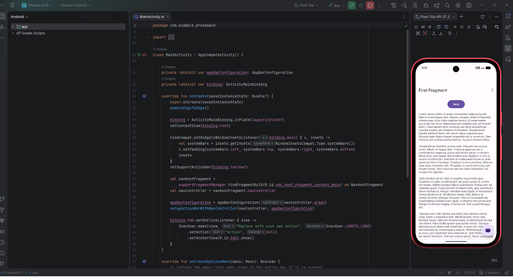
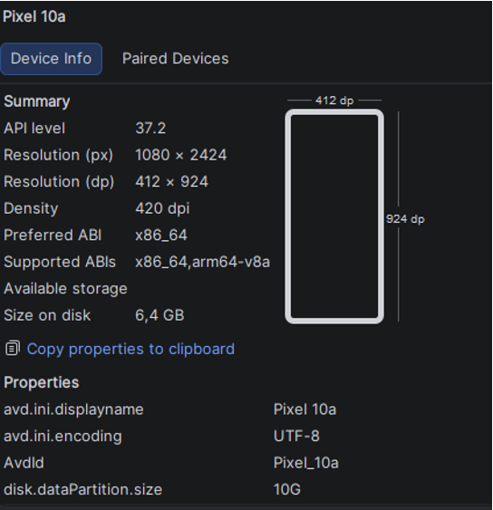
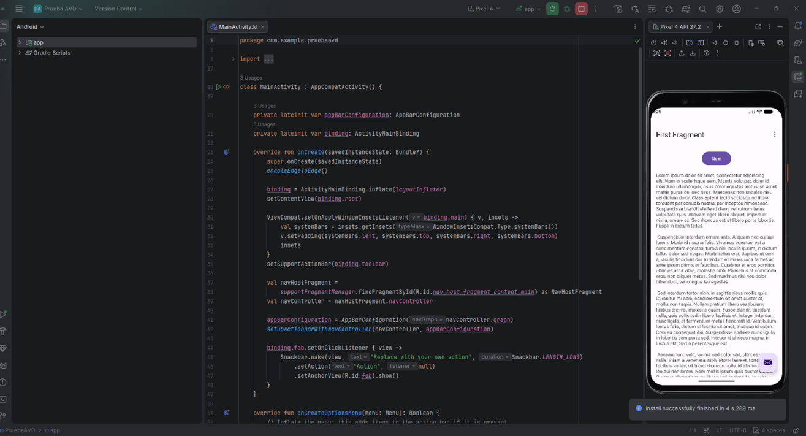
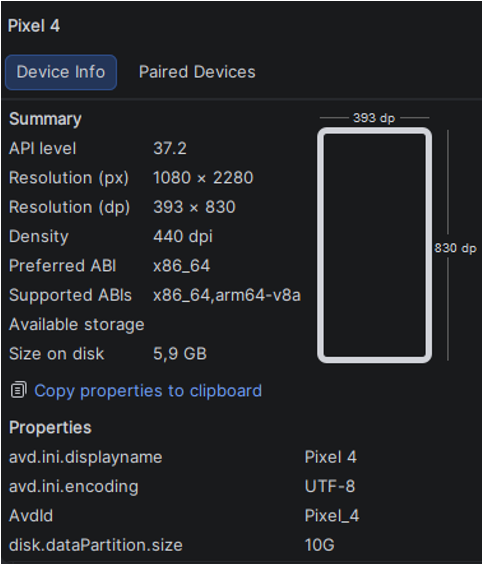
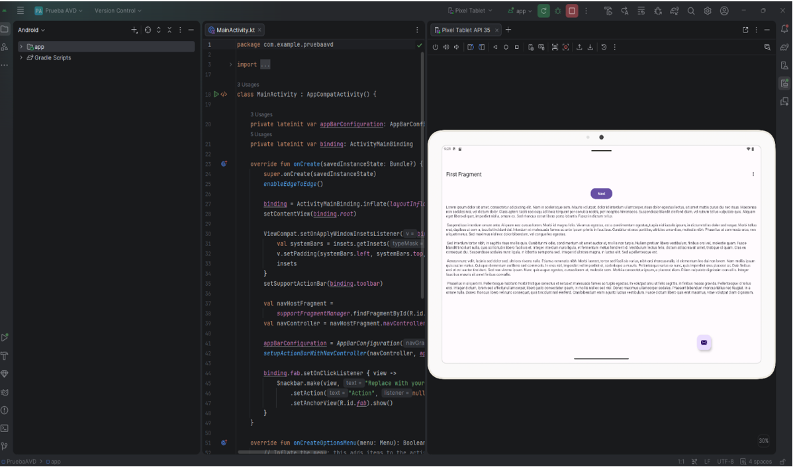
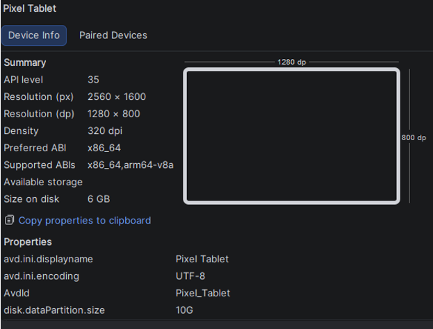

AVD 1 - GOOGLE PIXEL 10A

AVD 2 - GOOGLE PIXEL 4

AVD 3 - GOOGLE PIXEL TABLET

-- COMENTARIO SOBRE LAS DIFERENCIAS --

Entre el Google Pixel 10a y el Pixel 4 hay una diferencia abismal de rendimiento y fluidez.
Aunque sea un emulador tambien se nota diferencia en la calidad de imagen entre ambos.
Con la tablet tuve que jugar bastante con la rotación y la ventana para poder ver bien la app, al 
cambiar de teléfonos a una tablet, los layouts te dan otra visión con zonas vacías o botones pequeños.
Esto requiere que cuando preparemos la app nos demos cuenta de que tenemos que adaptarla a los
diferentes dispositivos.