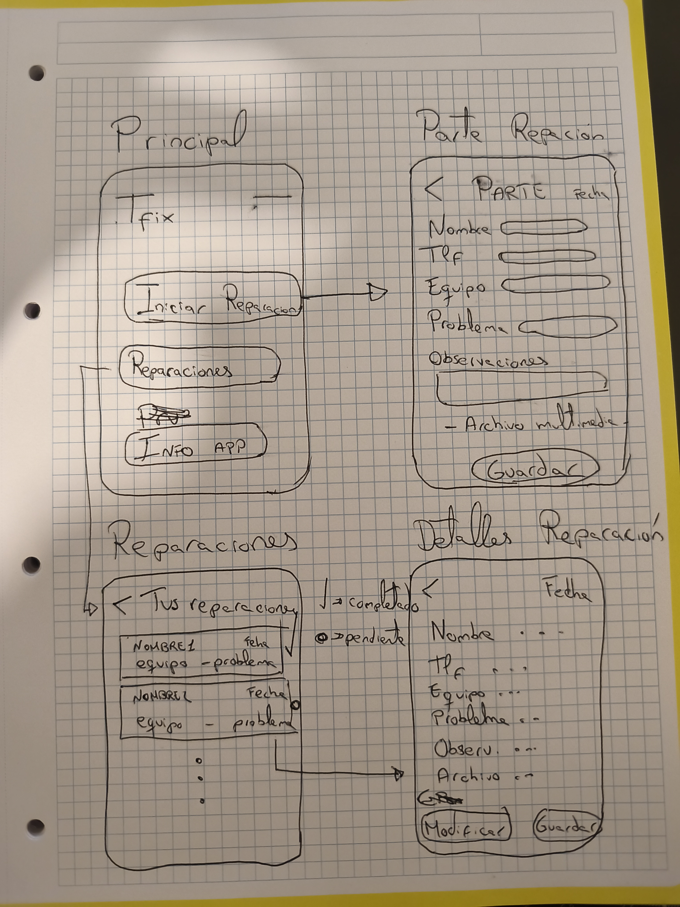

# Plantilla: propuesta del Proyecto A

---

## 0 · Datos

| | |
|---|---|
| Tfix| |
| Miguel Ángel Augusto Mosquera | |
| 29-09-2026 | |

---

## 1 · La idea en una frase

> Qué hace tu app y para quién, en una sola frase.
>
> Fórmula: «Una app que permite a [quién] hacer [qué] para [para qué].»

---Una app que permite, a todo técnico informático, tomar nota para hacer un parte de reparación de cualquier dispositivo y asi facilitar al técnico 
tener y tomar todos los datos guardados de cliente y dispositivo. 

## 2 · El problema

> ¿Qué problema resuelve? ¿Cómo se resuelve hoy sin tu app?

---Resuelve el hecho de tener un seguimiento de clientes, equipos, reparaciones... Todo guardado para cualquier problema o duda a futuro y hacer un seguimiento de problemas comunes o estadísticas.
Hoy en día muchos técnicos hacen partes a papel, también usan apps que cumplen su función pero les faltan opciones importantes que son necesarias. 

## 3 · Personas usuarias

> ¿Quién la va a usar? Describe a una persona concreta: edad, soltura con la
> tecnología, cuándo y dónde abre la app, cuánto tiempo le dedica y qué pasa
> si le falla.

---Toda persona que quiera dedicarse a las reparaciones, por eso mismo, de cualquier edad. La idea es hacerla simple, vistosa y funcional.
La app se abrirá bastante, para ver reparaciones completadas, pendientes, para tomar nota, para sacar fotos a los equipos...

## 4 · Funcionalidades

### Imprescindibles (sin esto la app no tiene sentido)

| # | Funcionalidad |
|---|---------------|
| F1 | Hacer un parte de reparación completo con datos de cliente y equipo|
| F2 | Almacenar los datos para hacer un seguimiento|
| F3 | Poder hacer fotos de los equipos para tener un seguimiento de como llega y como se entrega|

### Opcionales (si sobra tiempo)

| # | Funcionalidad |
|---|---------------|
| O1 | Poner una opción de probar los sensores del equipo donde está instalado |
| O2 | Tener una zona de estadísticas o informes|

---

## 5 · Pantallas

| Pantalla | Para qué sirve | Se llega desde |
|--------|---------------|----------------|
| (arranque) | Va a ser la pantalla principar donde apareceran todas las opciones
|  Pantalla parte | En esta se colocarán todos los datos | Se llega desde la pantalla arranque
|  Pantalla datos | Aparecen los partes guardados por fechas y puedes revisarlos. | Se llega desde la pantalla arranque
|  Pantalla detalle datos | Aqui puedes revisar o modificar especificaciones de los partes | Se llega desde pantalla datos 

---

## 6 · Bocetos

> Dibuja las pantallas principales. A mano y fotografiado es válido.
> Pega aquí las imágenes o indica el nombre de los archivos adjuntos.

---

## 7 · Qué datos guarda la app

| Tipo de dato | Campos | Ejemplo |
|-----------|--------|--------|
| Texto   | Nombre | Nombre cliente
| Numérico| Teléfono | Telefono cliente
| Boolean | Completado o pendiente | Reparación completada o pendiente
| Archivo multimedia | Imagen o video | Tomar imagenes o videos del equipo

---

## 8 · Encaje con los requisitos del módulo

> Apartado obligatorio: ninguna casilla puede quedar vacía.

| Requisito | Dónde encaja en tu app | Tema |
|-----------|------------------------|------|
| **Persistencia de datos** — la información sobrevive al cerrar la app | Para tener guardados todos los datos sobre los partes de reparación| 4 |
| **Servicio web** — la app consulta datos por internet | Para poder tener datos o referencias de los modelos de los equipos| 5 |
| **Sensor o localización** | Un entorno de pruebas dentro de la app para probar en los dispositivos| 6 |
| **Contenido multimedia** — foto, audio, vídeo o animación | Tomar imagenes o videos de los equipos antes y después de la reparación | 7 |

---

## 9 · Riesgos

| Lo que me preocupa | Plan B |
|--------------------|--------|
|  Que se sature de datos en poco tiempo | Que después de un tiempo haga un autoborrado
| No saber donde colocar las claves del dispositivo del cliente por miedo a hackeo | Buscar la forma de encriptar las claves o que se eliminen al completar la reparación

---

## Antes de entregar

- [*] La idea cabe en una frase.
- [*] El público es una persona concreta, no «todo el mundo».
- [*] Hay **3 o 4** funcionalidades imprescindibles, no diez.
- [*] Cada funcionalidad imprescindible tiene su pantalla.
- [*] Hay bocetos de las pantallas principales.
- [*] **Las cuatro casillas del apartado 8 están rellenas.**
- [*] Está identificado al menos un riesgo con su plan B.
